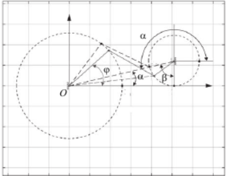

# Введение

В работе рассматриваются два вида анализа данных:

- дескриптивный анализ;
- механистический анализ.

Для каждого вида анализа выбрана научная статья с DOI. Цель работы - определить, почему выбранные исследования относятся именно к этим видам анализа данных.

# 1. Дескриптивный анализ

## 1.1. Общая характеристика

Цель дескриптивного анализа - описать и обобщить имеющиеся данные.

Используются:

- частоты;
- проценты;
- средние значения;
- распределения.

Основной вопрос: **«Что наблюдается в данных?»**

## 1.2. Пример дескриптивного анализа

Гаврилов С.М., Кудрова Е.М.

**«Анализ результативных технико-тактических действий игроков в пляжном футболе на примере Чемпионата мира 2021 года в России»**

DOI: 10.34835/issn.2308-1961.2023.05.p115-117

Статья: <https://cyberleninka.ru/article/n/analiz-rezultativnyh-tehniko-takticheskih-deystviy-igrokov-v-plyazhnom-futbole-na-primere-chempionata-mira-2021-goda-v-rossii/viewer>

Материал исследования:

- 4 матча финальной стадии ЧМ-2021 по пляжному футболу;
- по видеозаписям фиксировались голы и способы их забивания.

## 1.3. Результаты исследования

Основные результаты:

1. Всего зафиксировано 40 голов.
2. В среднем - 10 голов за матч.
3. 60% голов забито с игры.
4. 40% голов забито со стандартных положений.

Исследование относится к дескриптивному анализу, потому что авторы описывают уже произошедшие события с помощью количественных показателей и не строят модель прогноза.

# 2. Механистический анализ

## 2.1. Общая характеристика

Цель механистического анализа - понять, как изменение одних параметров системы приводит к изменению других.

Такой анализ часто используется в физических и инженерных задачах, где процессы можно описать математическими уравнениями.

Основной вопрос: **«Как работает система?»**

## 2.2. Пример исследования

В качестве примера используется статья:

**Мусалимов В.М., Паасуке М., Гапеева Е., Ерелине Я., Ерофеев М.А. «Моделирование динамики опорно-двигательной системы».**

DOI: 10.17586/2226-1494-2017-17-6-1159-1166

Статья: <https://cyberleninka.ru/article/n/modelirovanie-dinamiki-oporno-dvigatelnoy-sistemy/viewer>

В исследовании использовались экспериментальные данные о ходьбе четырех человек. На их основе была построена математическая модель движения нижней конечности.

Авторы рассматривали:

- фазу отталкивания - модель с одной степенью свободы;
- фазу переноса ноги - модель с двумя степенями свободы;
- влияние массы и геометрии частей ноги;
- упругость и вязкое сопротивление;
- частоты движения суставов.

## 2.3. Математическая модель и результаты

В модели угол поворота бедра $\varphi$ связан с углом поворота стопы $\alpha$ через параметр константности $k$:

$$
\varphi = k\alpha
$$

Для четырех обследуемых были получены следующие значения параметра $k$:

| Обследуемый | Параметр $k$ |
|---|---:|
| B | 0,5878 |
| M | 0,7159 |
| P | 0,3994 |
| A | 0,7095 |

Также в модели учитывались:

- масса частей конечности;
- длина бедра, голени и стопы;
- частота движения суставов;
- сила тяжести;
- упругое сопротивление;
- вязкое сопротивление.

> «Важную роль играют экспериментальные данные по доминирующим частотам фаз движений».

В результате авторы построили модель фазы отталкивания с одной степенью свободы и модель фазы переноса ноги с двумя степенями свободы.

Исследование относится к механистическому анализу, потому что движение нижней конечности описывается с помощью физических параметров и математических уравнений. Модель показывает, как изменение параметров системы связано с изменением движения.

### Кинематическая схема модели



На рисунке представлена кинематическая схема четырехзвенного механизма с одной степенью свободы, используемая авторами для моделирования фазы отталкивания.

# 3. Вывод

В работе были рассмотрены два вида анализа данных:

1. Дескриптивный анализ - используется для описания уже имеющихся данных с помощью количественных показателей.
2. Механистический анализ - используется для описания работы системы с помощью математических и физических зависимостей.

# Репозиторий проекта

Ссылка на GitHub-репозиторий:

<https://github.com/Artemirks/data-cleaning-labs>

```{r setup, include=FALSE}
knitr::opts_chunk$set(echo = TRUE)
```